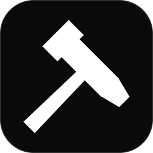

<p align="center"></p>

# Hammer Pro

**Un éditeur de maps moderne et rapide pour le moteur Source, pensé d'abord pour Garry's Mod.**

[Read in English](README.md) | [Documentation](docs/fr/README.md) | [Documentation in English](docs/en/README.md) | [Discord](https://discord.gg/eAEWWKRNAe)

Hammer Pro ouvre et enregistre des fichiers `.vmf` standard : vous pouvez l'utiliser en parallèle de Hammer et de Hammer++. Il est écrit en Rust, dessine avec la carte graphique grâce à wgpu, reste fluide sur les très grandes maps et compile les maps avec son propre compilateur intégré : ni VBSP, ni VVIS, ni VRAD.

Version **1.0.0**.

## Points forts

Chaque fonctionnalité a sa propre page dans la [documentation](docs/fr/README.md).

- **Chargement instantané.** Un VMF de 100 000 brushes est lu en 0,3 s environ. Le contenu du jeu (VPK, addons, Workshop) se monte en arrière-plan. Voir [Configuration du jeu](docs/fr/getting-started/game-setup.md).
- **VMF sans perte.** Les maps écrites par Hammer ressortent à l'identique, les données de Hammer++ (`vertices_plus`, blocs `*_plus`) sont conservées. Voir [Compatibilité VMF](docs/fr/getting-started/vmf-compatibility.md).
- **Tout votre contenu.** Les VPK du jeu, les addons et fichiers `.gma`, les addons du Workshop (y compris les anciens `.bin`), les jeux de `mount.cfg`, le contenu téléchargé depuis les serveurs et [vos propres dossiers de textures](docs/fr/features/custom-texture-folders.md), où de simples images PNG, JPG, TGA et BMP servent de matériaux.
- **Tous les outils de Hammer.** [Sélection](docs/fr/features/selection-tool.md) avec poignées, poignées d'étirement 3D et gizmo, [outil bloc et primitives](docs/fr/features/block-tool.md), [outil polygone](docs/fr/features/polygon-tool.md), [outil entité](docs/fr/features/entity-tool.md), [découpe](docs/fr/features/clip-tool.md), [outil vertex](docs/fr/features/vertex-tool.md), [displacements](docs/fr/features/displacement-tool.md), [application de texture](docs/fr/features/texture-tool.md), [décals et overlays](docs/fr/features/decals-overlays.md), [outil chemin](docs/fr/features/path-tool.md), [sprinkle](docs/fr/features/sprinkle-tool.md), [cordons](docs/fr/features/cordons.md), [groupes](docs/fr/features/groups.md), [visgroups](docs/fr/features/visgroups.md), [instances](docs/fr/features/instances.md), [prefabs](docs/fr/features/prefabs.md), [éditeur d'I/O](docs/fr/features/io-logical-view.md), [vérification des problèmes](docs/fr/features/check-problems.md).
- **Plus que Hammer.** Un [éditeur UV](docs/fr/features/uv-editor.md), un [éditeur de matériaux](docs/fr/features/material-editor.md), des [grilles personnalisées](docs/fr/features/grids.md) (un pas par axe, orientées, attachées aux objets), une [palette de commandes](docs/fr/features/command-palette.md), une [arborescence](docs/fr/features/outliner.md), une [vue logique](docs/fr/features/io-logical-view.md), l'[annulation de la sélection](docs/fr/features/undo-history.md), la [sauvegarde automatique et la récupération après plantage](docs/fr/features/autosave-crash.md), [plusieurs maps en onglets](docs/fr/features/multiple-maps.md).
- **Voir la map comme le jeu.** [Aperçu de l'éclairage en temps réel](docs/fr/features/lighting-preview.md) avec ombres, normal maps et reflets des cubemaps, un aperçu de l'éclairage précalculé, et une [vue joueur](docs/fr/features/player-view.md) (`F6`) qui parcourt le monde compilé avec ses lightmaps.
- **Props et modèles.** [Propper](docs/fr/features/propper.md) transforme des brushes en prop statique (avec LOD et collision) et des props en brushes, l'[import de modèles](docs/fr/features/model-import.md) amène des FBX, OBJ et glTF dans le jeu, le [navigateur de modèles](docs/fr/features/model-browser.md) affiche chaque modèle en 3D.
- **Son propre compilateur.** Géométrie, visibilité et éclairage (LDR et HDR, occlusion ambiante, éclairage des props statiques) pour Garry's Mod et d'autres jeux Source, avec recompilations intelligentes, précompilations en arrière-plan et un journal de compilation aux erreurs cliquables. Voir [Le compilateur intégré](docs/fr/compiler/overview.md) et [Jeux cibles](docs/fr/compiler/target-games.md).
- **Santé de la map.** Vérification des problèmes en direct, détection instantanée des fuites avec leur chemin, limites du moteur par jeu, fichiers de portails et visibilité. Voir [Fuites et pointfiles](docs/fr/features/leaks-pointfiles.md).
- **Publier.** [Ressources de la map](docs/fr/features/map-assets.md) liste et rassemble chaque fichier utilisé par la map, [Construire et enregistrer en contenu](docs/fr/features/build-content-release.md) prépare un addon prêt à partager avec une liste de contrôle et la publication sur le Workshop, [BSP Protection Pro](docs/fr/features/bsp-protection.md) livre une copie protégée de la map.
- **Aides au gameplay.** [Génération du nav mesh](docs/fr/features/nav-mesh.md), [plusieurs skybox 3D et une entité pour en changer](docs/fr/features/sky-cameras.md), [soundscapes](docs/fr/features/soundscapes.md), [aperçu des particules](docs/fr/features/particles.md), [lancement et rechargement en jeu](docs/fr/features/game-launch.md).
- **Assistants IA.** Un [serveur MCP](docs/fr/reference/mcp-server.md) intégré permet à Claude, Codex ou Gemini de lire et modifier la map ouverte, de la vérifier, de la compiler et de faire des captures d'écran, chaque modification formant une seule étape d'annulation.
- **Votre éditeur.** Interface noir et blanc (sombre ou claire), [anglais et français](docs/fr/features/themes-languages.md), [jeux de raccourcis de Hammer et Hammer++](docs/fr/features/keyboard-shortcuts.md), [statut Discord](docs/fr/features/discord.md).

## Configuration requise

- Windows 10 ou 11 (64 bits). Hammer Pro se compile aussi sous Linux depuis les sources.
- Une carte graphique compatible Vulkan, DirectX 12 ou Metal.
- Garry's Mod installé par Steam (trouvé automatiquement). D'autres jeux Source sont pris en charge comme cibles.

## Téléchargement et installation

1. Téléchargez `hammerpro.exe` depuis la page Releases de ce dépôt, ou [compilez-le depuis les sources](docs/fr/development/building.md).
2. Placez-le dans le dossier de votre choix et lancez-le. Il n'y a pas d'installateur.
3. Au premier lancement, l'assistant de configuration vous demande votre langue, l'éditeur dont vous venez (Hammer, Hammer++ ou les réglages de Hammer Pro) et le contenu de votre jeu.

Détails : [Installation](docs/fr/getting-started/installation.md) et [Configuration du jeu](docs/fr/getting-started/game-setup.md).

## Démarrage rapide

1. Ouvrez un `.vmf` (**Fichier > Ouvrir une map...**, `Ctrl+O`, ou glissez-le sur la fenêtre) ou créez une nouvelle map (`Ctrl+N`).
2. Dessinez une pièce avec l'outil bloc (`Maj+B`), placez des entités avec l'outil entité (`Maj+E`), texturez les faces avec `Maj+A`.
3. Appuyez sur `F9` pour compiler et lancer la map dans Garry's Mod.

Suivez [Votre première map](docs/fr/getting-started/first-map.md) pour un parcours complet.

| Action | Touches |
|---|---|
| Voler avec la caméra 3D | maintenir le clic droit + `Z Q S D` (`W A S D` en QWERTY), `Maj` pour aller plus vite |
| Activer ou couper la vue souris | `Z` |
| Faire défiler / zoomer les vues 2D | clic molette ou `Espace` + glisser / molette |
| Grille plus fine / plus large | `[` / `]` |
| Outils sélection, bloc, entité, texture, découpe, vertex | `Maj+S`, `Maj+B`, `Maj+E`, `Maj+A`, `Maj+X`, `Maj+V` |
| Palette de commandes | `Ctrl+P` |
| Compiler maintenant | `F9` |
| Vue joueur | `F6` |
| Tous les raccourcis | `F1` |

Tous les raccourcis sont listés dans [Actions et raccourcis clavier](docs/fr/reference/actions-shortcuts.md) et se modifient dans **Paramètres > Clavier**.

## Compiler depuis les sources

```bash
git clone <ce dépôt>
cd HammerPro
cargo build --release -p hammerpro
```

L'exécutable est `target/release/hammerpro.exe`. Il faut Rust 1.95 ou plus récent. Lancez les tests avec `cargo test --workspace` (les tests qui ont besoin de Garry's Mod se désactivent s'il n'est pas installé). Voir [Compiler depuis les sources](docs/fr/development/building.md) pour les profils de compilation et [Architecture](docs/fr/development/architecture.md) pour les crates.

## Documentation

- [Documentation en français](docs/fr/README.md) : prise en main, une page par fonctionnalité, le compilateur, les références (paramètres, raccourcis, ligne de commande, scripts, MCP), des guides, le dépannage et le développement.
- [English documentation](docs/en/README.md).
- [Référence des outils MCP](docs/MCP.md) (générée, en anglais) et [guide du développeur pour étendre Hammer Pro](docs/EXTENDING.md) (en anglais).

## Communauté et contact

- Serveur Discord : [discord.gg/eAEWWKRNAe](https://discord.gg/eAEWWKRNAe) (aide, retours, signalement de bugs, nouveautés)
- L’auteur sur Discord : `oracleidt`

## Contribuer

Les contributions sont les bienvenues. Lisez d'abord [CONTRIBUTING.md](CONTRIBUTING.md). Les traductions sont à côté du code, dans la table `TR` de chaque crate (anglais et français) ; ajouter une langue revient à ajouter une colonne.

## Licence

MIT. Voir [LICENSE](LICENSE).

Hammer Pro n'est affilié ni à Valve ni à Facepunch Studios. Source, Hammer et Garry's Mod sont des marques de leurs propriétaires respectifs. Hammer Pro n'inclut ni ne redistribue aucun code ni contenu de jeu de Valve.
